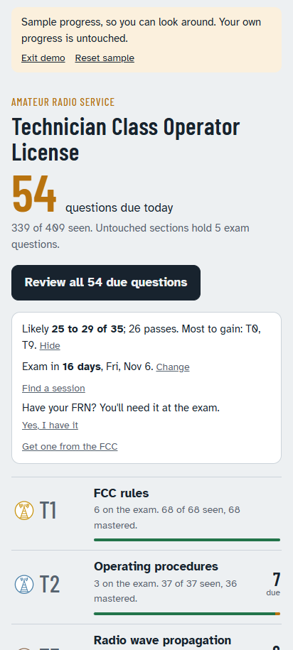
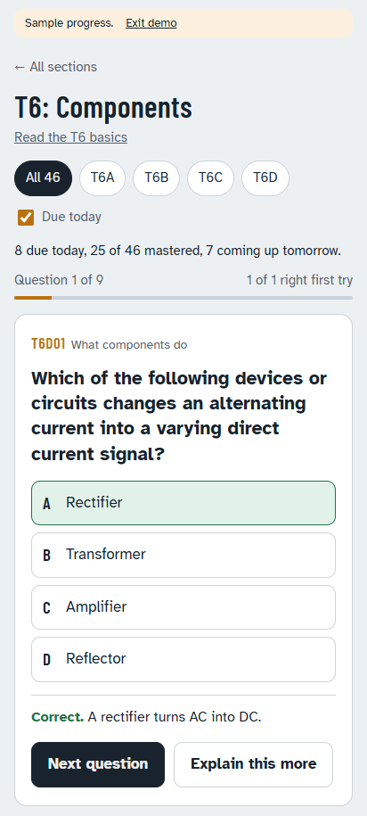

# Technician drills

A study app for the US amateur radio license exams. The Technician drills hold all 409 questions of the 2026-2030 pool, worded exactly as on the exam; the General drills hold all 423 questions of the 2023-2027 pool (6th errata). Both use spaced review: a card comes back after one day, then three, then seven, and three right answers on separate days master it. Every question has a short note and a longer explanation, and every topic has a primer shown before its first new question.

Set an exam date and nothing is scheduled past it; in the last week every card comes back once more. The home screen estimates the exam score as a range and names the sections with the most to gain, and offers a practice exam drawn the way the real one is, one question per group, with the misses as a drill afterwards. Each section earns bronze, silver and gold badges, judged on every card.

It is one web page with no framework and no server. It installs to a phone's home screen, works with no signal, and keeps progress on the phone.

**Try it with sample progress:** https://daseme.github.io/ham-drills/technician/?demo

**Use it for real:** https://daseme.github.io/ham-drills/ (Technician and General)

## Running it

Open technician/index.html in a browser. That runs everything except offline install, which needs the page served: run `python -m http.server 8000` in this folder and browse to http://localhost:8000/technician/.

To host it, put the files on any static host with HTTPS; GitHub Pages serves this repo. On Android, open the address in Chrome and choose Add to Home screen. On an iPhone, use Safari, Share, Add to Home Screen, and open it from that icon: Safari clears data for ordinary websites after a week without a visit.

## Releasing

Change files, then raise `APP_VERSION` in version.js. That one number is the footer's version and the service worker's cache name, so installed copies fetch the new files the next time they open online and switch at the next safe moment. CHANGELOG.md lists every version.

## Checking

    node tools/pool-check.js
    node --test "test/*.test.js"

The pool check confirms every question is well formed: four options, a valid answer, unique ids, exam counts summing to 35. Given the NCVEC pool file from https://ncvec.org/index.php/2026-2030-technician-question-pool, it also compares every id, stem, option and answer; data.js matches the February 19, 2026 errata release exactly. The tests (Node 22 or later, no packages) cover the scheduler, the exam cap, the estimate, the badges, backups, the practice exam draw and scoring, the data layout and the demo. GitHub runs both on every push, keeps data.js at one question per line (`node tools/data-format.js technician/data.js` after editing), and shoots every screen in Chrome to compare with the baselines in test/screens; after a deliberate change to a screen, run the check workflow by hand with rebaseline on.

## Progress

Progress is stored on the phone and nowhere else. Export progress on the home screen makes a backup file; Import progress merges one back, keeping the newer record for each card.

## More

ARCHITECTURE.md explains how it works: the files, the data format, storage, the scheduler, the estimate, the badges, demo mode and the service worker. For practice exams under exam conditions, use HamStudy.org. Pool text is from the NCVEC and is public domain; the code is MIT licensed. Files in private/ are ignored by git.
